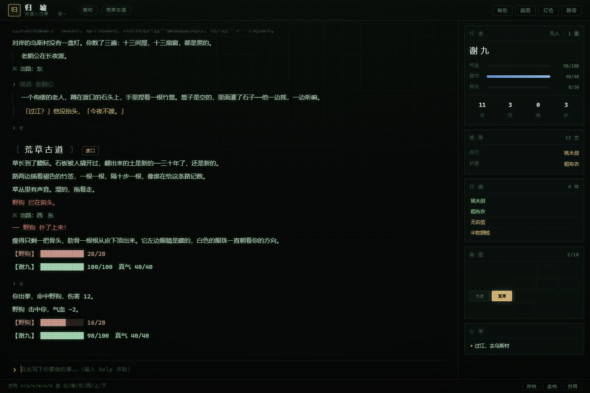
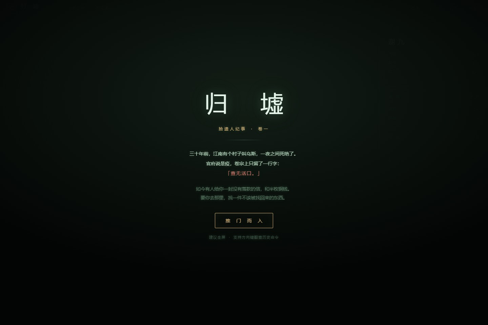
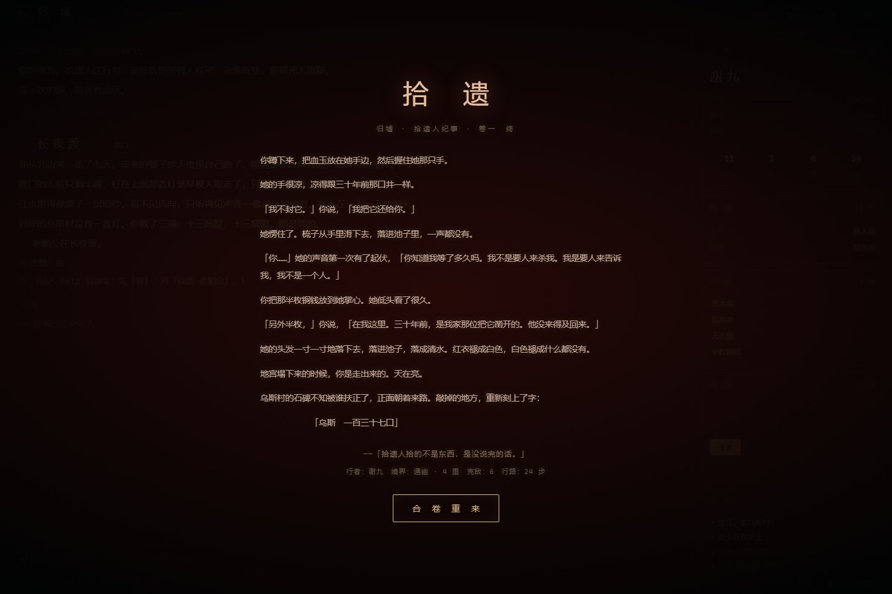

# 归墟 · 拾遗人纪事

> 一个中式志怪风格的**文字 MUD**。纯前端、零依赖、无构建——双击 `index.html` 就能玩。

[](https://3cancanneed.github.io/guixu-mud/)
[](LICENSE)
[](#)
[](#)

**▶ [点这里直接玩](https://3cancanneed.github.io/guixu-mud/)**

> 三十年前，江南有个村子叫乌斯，一夜之间死绝了。
> 官府说是疫，卷宗上只留了一行字：
> **「查无活口。」**
>
> 如今有人给你一封没有落款的信，和半枚铜钱。
> 要你去那里，找一件不该被找回来的东西。

<p align="center"></p>

## 这是什么

一个用 HTML/CSS/JS 手写的单人 MUD：文字界面、房间与方向移动、拾取与装备、NPC 对话、回合制战斗、商店、任务、存读档、结局。没有框架，没有依赖，没有构建步骤。

界面做成了 CRT 磷光终端的样子，三套灯色（青磷 / 琥珀 / 月白），窄屏下侧栏会变成抽屉。

## 截图

| 开场 | 结局 |
| --- | --- |
|  |  |

## 怎么玩

双击 `index.html`（Chrome / Edge / Firefox 都行），点「推 门 而 入」。
在底部输入框打字，回车执行。**输入 `help` 看全部指令。**

```
看 / look            看四周；也可以「看 石碑」「看 野狗」细看某物
走 北 / n            移动。方向：n s e w u d 或 北南东西上下
拿 刀 / take         拾起地上的东西
用 药 / use          服丹药；「读 信」展信
装备 剑 / 穿 袍      换兵刃、换护身
打 野狗 / attack     动手
说话 老人 / talk     与人对话（多谈几次，话会不一样）
买 / 卖 / list       货郎处交易
休息 / rest          只在土地庙可行，回满气血与真气
背包 / 属性 / 技能 / 任务 / 地图
存档 / 读档          进度存在浏览器 localStorage 里
```

**战斗**是回合制：`a` 普攻、`1`~`5` 出招（耗真气）、`用 药`、`f` 逃。
赢了有修为和掉落；死了会被抬回长夜渡，掉一部分修为和铜钱。

**界面**：方向键 ↑↓ 翻历史命令，「再」重复上一条；顶栏能切灯色、开环境音（WebAudio 合成的风声）；底栏存读档。

## 内容

- **11 个房间**：长夜渡 → 荒草古道 → 乌斯村 → 土地庙 / 枯井 → 义庄 → 后山竹林 → 墓道 → 明堂 → 血池 → 归墟
- **有锁的门**：井口要铜钥匙，墓道要有火折子才看得见路
- **6 种妖怪**：野狗、山魈、纸人、尸傀、守墓人、血衣道人，各有自己的出手描述
- **3 个 NPC**：老艄公、货郎（带商店）、老庙祝，各 3 段递进对话
- **5 个招式 / 6 件装备 / 6 种消耗品**
- **4 个结局**：破晓、续命、路人、拾遗（隐藏结局要集齐四条线索）

## 部署到 GitHub Pages

这个仓库本身就是可以直接托管的静态站点，根目录的 `index.html` 就是入口。

1. 打开仓库 **Settings → Pages**
2. **Source** 选 `Deploy from a branch`
3. **Branch** 选 `main`，目录选 `/ (root)`，保存
4. 等一两分钟，访问 `https://<你的用户名>.github.io/guixu-mud/`

改代码后 `git push`，Pages 会自动重新发布。

## 项目结构

```
.
├── index.html            页面骨架（顶栏 / 日志 / 侧栏 / 输入框 / 开场幕布）
├── css/
│   └── style.css         视觉：CRT 终端、扫描线、三套灯色、响应式
├── js/
│   ├── data.js           世界数据：房间、物品、妖怪、NPC、招式、结局
│   ├── engine.js         引擎：指令解析、移动、战斗、存档序列化
│   └── main.js           渲染层：DOM、键盘、音效、结局层
├── screenshots/          README 用的截图
├── favicon.svg / .png    站点图标
├── LICENSE               MIT
└── README.md
```

约 2900 行，其中 `data.js` 是纯内容，`engine.js` 是可独立在 Node 里跑的逻辑（没有 DOM 依赖）。

## 技术笔记

- **不用 ES module**：`file://` 协议下 `<script type="module">` 会被 CORS 拦住，所以全部用普通 `<script src>`，保证"双击就能玩"。
- **存档**是 `localStorage['guixu.save.v1']` 里的一段 JSON，可以备份、也可以手动改着玩。
- **对齐**：中文在等宽字体里宽度不一定是半角的两倍，所以地图用「全角宽度感知 + 固定格宽」算好再画，帮助表格则交给 CSS Grid。
- **无外部资源**：没有图片、字体、CDN 依赖，整个游戏就是那几个文本文件。

## 许可

[MIT](LICENSE) © 2026 3canCanNeed
